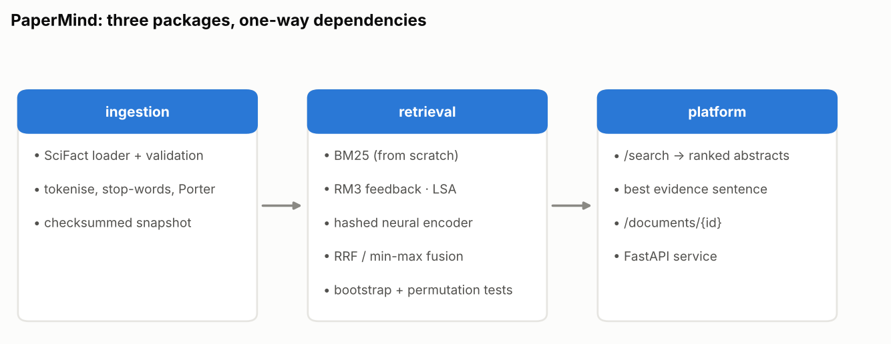
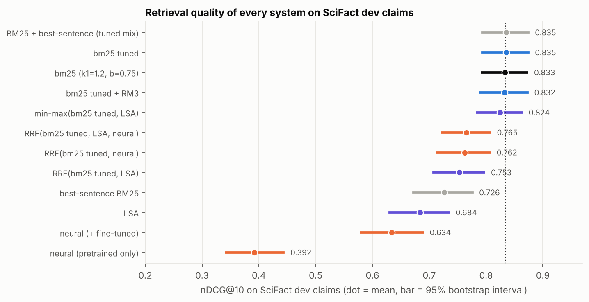
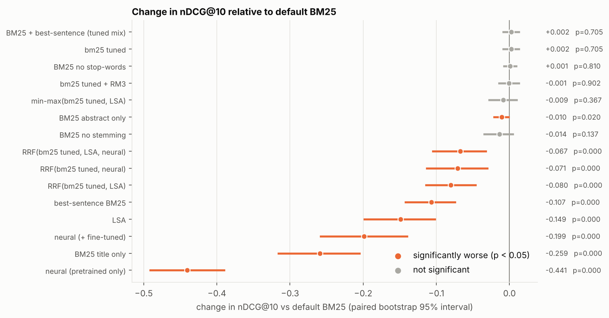
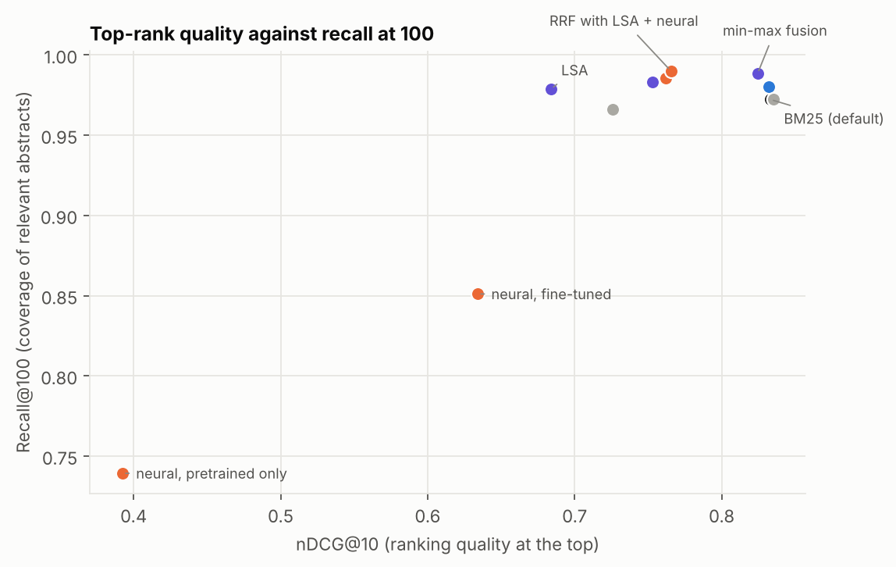
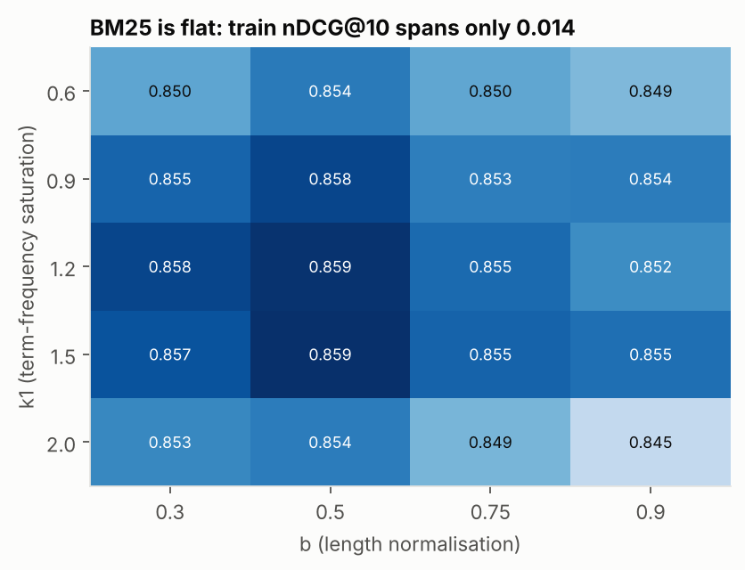

# PaperMind

Scientific-claim **evidence retrieval** on the SciFact benchmark: given a claim, find the
abstracts that support or contradict it, and show which sentence matters.

Three independently installable packages with one-way dependencies:

```
papermind-ingestion  ──▶  papermind-retrieval  ──▶  papermind-platform
 load/validate SciFact,    BM25 (from scratch), RM3,      FastAPI search service with
 text analysis, snapshot   LSA, neural dual-encoder,      sentence-level evidence
 (nltk only)               fusion, stats (torch)          highlighting
```

| Package | Responsibility |
|---|---|
| [`papermind-ingestion`](papermind-ingestion) | typed records, strict SciFact validation, tokenisation/stemming, checksummed corpus snapshot |
| [`papermind-retrieval`](papermind-retrieval) | retrievers, fusion, ranking metrics, bootstrap and permutation tests, the study runner |
| [`papermind-platform`](papermind-platform) | `/search`, `/documents/{id}`, `/health` over the snapshot |



## Research question

Strong lexical baselines are hard to beat on small scientific benchmarks. The study asks
which components genuinely help, with paired significance tests instead of single-number
comparisons: preprocessing (stemming, stop-words, title vs. abstract), BM25 parameter tuning,
pseudo-relevance feedback, latent semantic retrieval, a small trainable neural retriever, and
rank fusion, all tuned on training claims and reported on dev claims.

This is a controlled ablation study. It does not claim a new retrieval method.

## Status

| Item | State |
|---|---|
| All packages implemented, unit-tested (including tests against the real SciFact files) | yes |
| SciFact study | see `papermind-retrieval/results/REPORT.md`; if it is absent the study has not been run |
| Pretrained dense encoders (SPECTER, BGE, ...) | **not evaluated**: model hosting was unreachable from the development environment |
| Citation-graph reranking | **not tested**: SciFact has no citation graph |
| Database / vector store | not used (in-memory index) |

## Results (SciFact dev, 188 claims with evidence, 5,183 abstracts)

Full tables with confidence intervals, ablations, tuning and error analysis:
[`papermind-retrieval/results/REPORT.md`](papermind-retrieval/results/REPORT.md), generated
from `scifact.json` in the same folder. Hyper-parameters were tuned on 505 training claims.
Headline numbers, copied from the report:



| system | nDCG@10 [95% CI] | Recall@100 |
|---|---|---|
| BM25 (k1=1.2, b=0.75) | 0.833 [0.792, 0.872] | 0.972 |
| BM25 tuned (k1=1.5, b=0.5) | 0.835 [0.793, 0.874] (+0.002, p=0.705) | 0.972 |
| BM25 + RM3 | 0.832 [0.790, 0.873] (−0.001, p=0.902) | 0.980 |
| LSA (512 dims) | 0.684 [0.631, 0.734] | 0.979 |
| best-sentence BM25 (score = best sentence) | 0.726 [0.673, 0.776] | 0.966 |
| BM25 + best-sentence, mix tuned on train | 0.835 [0.793, 0.874]; the tuned weight on the sentence score was **0**, so identical to tuned BM25 | 0.972 |
| min-max fusion(BM25, LSA) | 0.824 [0.784, 0.863] (−0.009, p=0.367) | 0.988 |
| RRF(BM25, LSA, neural) | 0.765 [0.722, 0.807] | 0.990 |
| neural dual-encoder (fine-tuned) | 0.634 [0.580, 0.689] | 0.851 |



What this supports, and what it does not:

- On this benchmark, **nothing tested beat default BM25 on nDCG@10**; tuning and
  pseudo-relevance feedback made no significant difference, and fusing BM25 with weaker
  retrievers lowered nDCG@10 (RRF variants: −0.067 to −0.080, p < 0.001).
- Fusion did raise Recall@100 (0.972 → 0.983–0.990), which would matter for a re-ranking
  pipeline; that difference was not tested for significance.
- A passage-level signal (score a document by its best-matching sentence) is worse alone
  (0.726, −0.107, p < 0.001) and the mixing weight tuned on training claims was 0, so it adds
  nothing here. All earlier numbers reproduced exactly when the study was rerun.
- Title-only retrieval is much worse (−0.259); abstract-only is slightly worse than
  title+abstract (−0.010, p=0.020); stemming and stop-word removal effects are small.
- The paired p-values are uncorrected for the 15 comparisons against default BM25 (per metric); treat p-values near
  0.02 with caution.
- The neural retriever is a small hashed-feature model, not a pretrained transformer, so
  these results say nothing about modern dense retrievers. The BM25 numbers are not
  comparable with published BEIR figures, which use a different query set and protocol.





## Quick start

```bash
git clone https://github.com/saaki05/project-3 && cd project-3
pip install -e papermind-ingestion -e papermind-retrieval -e papermind-platform
# download SciFact (data.tar.gz) yourself and extract it, then:
papermind-retrieval study --data /path/to/scifact/data --out papermind-retrieval/results/scifact.json
papermind-retrieval report --results papermind-retrieval/results/scifact.json
papermind-ingest build --raw /path/to/scifact/data --out data/snapshot
papermind-serve --data data/snapshot
```

## Data and licenses

SciFact (Wadden et al., "Fact or Fiction: Verifying Scientific Claims", EMNLP 2020). Per the
upstream `LICENSE.md` when this was written: claims and annotations CC BY 4.0, abstracts
(from S2ORC) ODC-By 1.0. Verify upstream before redistributing; no data is included here.

## Regenerating the figures

Every figure in `docs/figures/` is produced from the result files by a script (no number is
typed by hand). `pip install matplotlib`, then:

```bash
python scripts/make_figures.py
```

## License

MIT.
