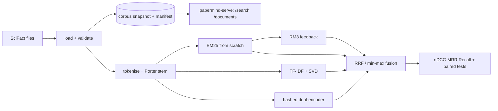

# PaperMind: methodology and paper outline

## Architecture

## Task and data

SciFact: 5,183 abstracts; claims written by annotators with evidence abstracts and rationale
sentences. Task here: rank abstracts for a claim; relevant = abstracts in the claim's
evidence set. Claims without evidence are excluded from retrieval metrics. The public test
claims have no labels, so training claims are used for tuning and dev claims for reporting.

## Protocol

- All hyper-parameters are selected on training claims by nDCG@10: BM25 `(k1, b)` grid,
  RM3 `(feedback docs, terms, interpolation)` grid, LSA dimension.
- Reported systems: BM25 default, BM25 tuned, BM25 + RM3, LSA, RRF and min-max fusion,
  neural retriever (pretrained on title→abstract pairs, then fine-tuned on training
  claim→cited-abstract pairs; 3 seeds), fusions with the neural system.
- Ablations at default BM25 settings: no stemming, no stop-words, title only, abstract only.
- Statistics: percentile bootstrap CI of the mean over queries; paired bootstrap and
  sign-flip permutation tests of each system against default BM25.
- Error analysis: claims missed at 10 / 100, hit rate by number of relevant abstracts, a
  sample of misses with their relevant titles.

## Threats to validity

- Hundreds of dev claims: small differences are not significant.
- Tuning on training claims and reporting on dev avoids optimistic bias, but the dev set has
  been looked at when writing this study; a final claim should be confirmed on a fresh split.
- The neural retriever is small and hashed; it is not evidence about pretrained encoders.
- Title→abstract pretraining touches every corpus document (including those relevant to dev
  claims) but uses no claim or label information.

## Paper outline (fill from `results/REPORT.md` only)

1. Introduction: strong lexical baselines on small scientific benchmarks.
2. Related work: BM25, RM3, LSA, dual encoders, rank fusion, SciFact.
3. Study design and statistics.
4. Results: system comparison, ablations, fusion, error analysis.
5. Limitations (no pretrained dense retriever, no citation graph) and conclusion.
